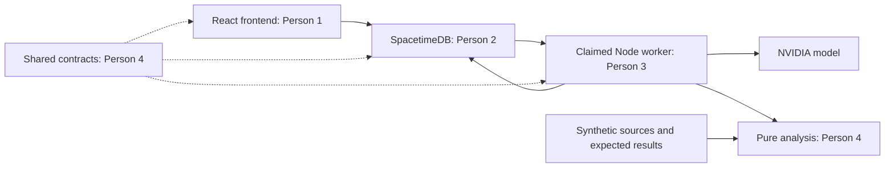

# Architecture and implemented boundary

Solid application connections are intended architecture, not already connected services. The foundation implements shared contracts, analysis, fixtures, and local verification. This separate integration branch also tests database jobs and persistence through a narrow adapter; the web app and live model are not connected.

SpacetimeDB owns authoritative application state, authorization, job claims, findings, revisions, human decisions, and atomic simulated release. The worker owns model/extraction execution and private local development bytes. The browser uses generated bindings behind a domain adapter. A byte-upload transport must not duplicate business CRUD or bypass database authorization.

Package boundaries:

- contracts/domain: plain interfaces and constants, no runtime imports.
- contracts: domain exports plus Zod runtime schemas and reference validation.
- analysis: pure helpers using only contracts/domain; does not load Zod.
- scripts/evaluate.mjs: Node-only source/evaluation tooling, never imported by browser/server domain code.
- fixtures/views: deliberately synthetic UI inputs; never an automatic live-connection fallback.

No SDK versions, generated bindings, live endpoint, or deployment are selected on behalf of other owners. Person 2 pins the database toolchain; Person 3 verifies the actual NVIDIA model/tool protocol; Person 1 implements session-aware subscriptions. Root workspace and lockfile changes should be coordinated through Person 4.
